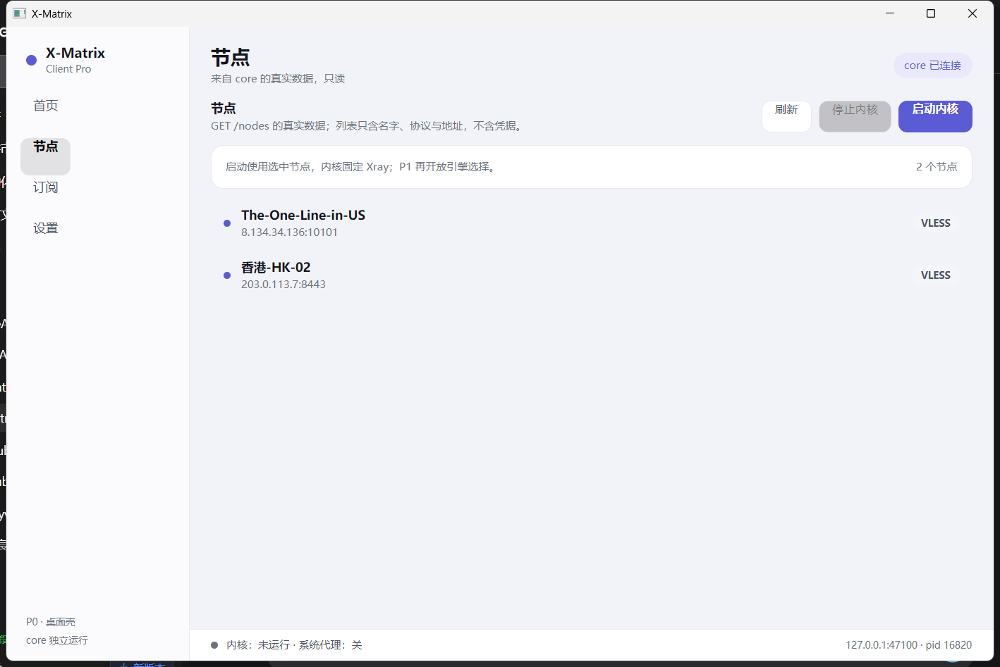

# P0 报告 — headless core + Avalonia 骨架

日期：2026-11-28
范围：只做 `docs/REWRITE-P0-TASK.md` 的 P0；`engine/`、`sysproxy/`、`net/`、`service.rs`、
`src/` 下 Vue/TS、`docs/ACCEPTANCE.md`、`docs/ISSUES.md`、`docs/REWRITE-PLAN.md` 与三份
i18n 均未改动。没有 `git commit` / `git push`。

## 结论

第 1–7 条本机验收通过；第 8 条（云电脑起内核 / 点启动停止 / ProxyEnable）**未做**，
留给主窗口在 cloudpc-test 上跑。本机没有启动任何内核，也没有写系统代理注册表。

一个环境限制需要主窗口知道（见第 3 条注）：本机 DSH 沙箱只允许**工作区外**的可执行
文件写 `%APPDATA%`；`src-tauri\target\release\x-matrix.exe` 直接跑时 `fs::write` 被
拒绝（os error 5），把**同一个二进制**复制到 `D:\CODE.config\p0probe\x-matrix.exe`
再跑就正常写出真实端点文件。这不是程序缺陷，是执行环境的工作区写入限制；正式安装包
不在工作区里，不受影响。第 4/5 条的实测运行用的是这个副本。

## 交付物

| 路径 | 内容 |
|---|---|
| `src-tauri/src/core/mod.rs` | `CoreContext`、`--serve`/`--port` 解析、`serve()`、无 Tauri 的目录/状态/运行时/代理组装；**不调用** `ProxyGuard::recover()` |
| `src-tauri/src/core/http.rs` | 手写 HTTP/1.1：单行请求行 + header + `Content-Length` 正文 + `Connection: close`；无 axum/hyper |
| `src-tauri/src/core/endpoints.rs` | 五条路由 + 错误体；先验 token 再路由 |
| `src-tauri/src/core/server.rs` | loopback 监听、token、端点文件 tmp+rename、`/shutdown` 后 drain 并清理 |
| `src-tauri/src/lib.rs` | 加一行 `pub mod core;` |
| `src-tauri/src/main.rs` | 在 `run()`/`--export-contract` 之前分流 `--serve`，不建窗口 |
| `desktop/XMatrix.Desktop/**` | Avalonia 11（11.3.23）+ net10.0 骨架：左侧导航四项、节点页读 `/nodes`、启动/停止、状态行 |
| `desktop/README.md` | build / 与 core 同跑 / 收尾 shutdown / 已知缺口 |
| `desktop/screenshots/p0-nodes.png` | 节点页截图（2 条节点名可见） |
| `P0-REPORT.md` | 本文件 |

路由与错误体：

- `GET /health` → `{"ok":true,"version":"0.1.0"}`
- `GET /status` → `EngineStatus` 全字段 + `proxy:{active,enabled,server,snapshot_present}`
- `GET /nodes` → `[{id,name,protocol,host,port}]`，protocol 为小写 slug，不含密钥/订阅正文
- `POST /engine/start` body `{"kind":"xray"|"sing-box","nodeId":"..."}`
- `POST /engine/stop`
- 错误：`{"error":{"code":"...","message":"中文"}}`，code ∈ `unauthorized` / `not_found` /
  `invalid_input` / `io` / `engine` / `internal`
- token：`X-Core-Token`，缺失或不匹配都是 401；未知路由（含 token 正确时）是 404
- endpoint：`%APPDATA%\com.xmatrix.client\core.endpoint`，JSON `{port,token,pid}`，tmp+rename；
  `--port 0` 时写系统分配的真实端口

## 第 3 节验收逐条

| # | 命令 | 结果 |
|---|---|---|
| 1 | `npm run check` | **通过**：typecheck / check:arch / check:contract 全过，vitest `13 files / 136 tests` 全绿 |
| 2 | `cd src-tauri && cargo test --lib` | **通过**：`564 passed; 0 failed`（539 原有 + 25 新增 core 单测）。新增覆盖 401（缺失/错误 token）、404（未知路由）、错误体形状、端点文件发布/删除、双节点 `/nodes`、坏 kind、缺 node、`/shutdown` 标志、token 形状、端口占用 |
| 3 | `cargo build --release`；`target/release/x-matrix.exe --serve --port 47100` | **通过（有环境注）**：release 构建成功；进程启动后 `Get-Process x-matrix` 的 `MainWindowHandle=0`、无 `MainWindowTitle`，桌面上没有新窗口。注：工作区内 exe 被沙箱拒绝写 `%APPDATA%`，改用同一二进制的副本 `D:\CODE.config\p0probe\x-matrix.exe` 实测（见开头说明） |
| 4 | `curl -s -H "X-Core-Token: <token>" http://127.0.0.1:47100/health`；不带 token；错 token | **通过**：带 token → `{"ok":true,"version":"0.1.0"}`；不带 → `HTTP 401` + `{"error":{"code":"unauthorized","message":"X-Core-Token 缺失或不匹配"}}`；错 token 同样 401 |
| 5 | `curl -s .../nodes` | **通过**：返回 2 条，与种子 `store.json` 一致：`The-One-Line-in-US`（8.134.34.136:10101，vless）、`香港-HK-02`（203.0.113.7:8443，vless）；无 uuid/password 等秘密 |
| 6 | `dotnet build desktop/XMatrix.Desktop` | **通过**：`0 个警告 / 0 个错误`（SDK 10.0.404，`DOTNET_ROOT=D:\CODE.config\dotnet`） |
| 7 | 本机运行 Avalonia，节点页截图 | **通过**：截图 `desktop/screenshots/p0-nodes.png`，页面标题「节点」、右上「2 个节点」、两条节点名与地址、协议 `VLESS` 均可见；没有点「启动内核」 |
| 8 | 云电脑：同上 4–5 + 点「启动」 | **未做**，留给主窗口；需要内核二进制与真机代理注册表验证 |

截图：



## 实测命令与关键输出

```text
$ npm run check
Test Files  13 passed (13)
     Tests  136 passed (136)

$ cd src-tauri && cargo test --lib
test result: ok. 564 passed; 0 failed; 0 ignored; 0 measured; 0 filtered out; finished in 1.63s

$ cargo build --release
Finished `release` profile [optimized] target(s) in 4m 14s

$ ./x-matrix.exe --serve --port 47100      # 副本，工作区外
# endpoint: {"port":47100,"token":"2ac8…","pid":16820}

$ curl -s -H "X-Core-Token: $TOKEN" http://127.0.0.1:47100/health
{"ok":true,"version":"0.1.0"}

$ curl -s -o /dev/null -w 'HTTP %{http_code}\n' http://127.0.0.1:47100/health
HTTP 401

$ curl -s -H "X-Core-Token: $TOKEN" http://127.0.0.1:47100/nodes
[{"host":"8.134.34.136","id":"vless-18ea2e7eabfffa7c-0","name":"The-One-Line-in-US","port":10101,"protocol":"vless"},
 {"host":"203.0.113.7","id":"vless-demo-hk-1","name":"香港-HK-02","port":8443,"protocol":"vless"}]

$ curl -s -H "X-Core-Token: $TOKEN" http://127.0.0.1:47100/nope
{"error":{"code":"not_found","message":"未知路由：GET /nope"}}
HTTP 404

$ curl -s -X POST -H "X-Core-Token: $TOKEN" http://127.0.0.1:47100/shutdown
{"ok":true}
HTTP 200
# 2 秒后 endpoint 不存在，Get-Process x-matrix 数量 = 0
```

`dotnet build`：

```text
XMatrix.Desktop -> ...\bin\Debug\net10.0\XMatrix.Desktop.dll
已成功生成。
    0 个警告
    0 个错误
```

## 设计说明（为什么这么做）

- **core 与服务端不引入 Tauri**：`AppState` / `EngineRuntime` / `ProxyGuard` 本来就不依赖
  Tauri；`serve()` 按 `lib.rs` 的 `setup` 顺序组装，只是把 `guard.recover()` 留在 GUI 启动
  路径。这样 headless 进程能直接复用现有状态与内核生命周期，不需要第二套实现。
- **先验 token 再匹配路由**：未知路由在无 token 时也回 401 而不是 404，避免未认证的探测
  区分「路由不存在」和「token 错」。
- **端点文件用 tmp+rename**：UI 可能每一帧都在读，写入端保证自己原子；`/shutdown` 先关
  监听、等 3 秒在途响应、删端点、`release_if_active()`、`runtime.stop()`，最后进程退出。
  删除端点文件不是错误（NotFound 忽略）。
- **不在 headless 里 recover 代理快照**：`recover()` 会写注册表。P0 的 core 可以被任意
  终端启动，不能因为跑一次 `--serve` 就改用户的系统代理；真正的恢复仍由 GUI 的启动路径
  负责。`/engine/start` 的代理开关仍走 `commands::engine::start_engine`，与桌面端行为
  一致（云电脑第 8 条验证）。
- **HTTP 手写**：照 `net/http.rs` 的极简风格，50 行级别的请求解析；无 keep-alive、无 TLS，
  只绑 `127.0.0.1`。
- **桌面端只做客户端**：读端点文件 → `HttpClient` + `X-Core-Token`；启动按钮只是
  `POST /engine/start`（P0 固定 `xray`，P1 再把内核选择暴露出来）。颜色/圆角/尺寸取自
  `src/styles/tokens.css` 的 light 值；没有自造色板。

## 已知缺口 / 留给 P1

1. **第 8 条未验**：云电脑上点「启动」→ 内核 PID、`/status.running=true`、`ProxyEnable=1`、
   点「停止」还原，必须真机做；本机按硬规则不碰。
2. 桌面端没有端点文件 watcher：core 重启后要点「刷新」；P1 接 `FileSystemWatcher`。
3. `/status` 的 `proxy.enabled/server` 来自 core 启动时对注册表的**只读**读取；P0 不主动
   改写。若用户先开了别的代理，这里会如实显示那个代理，而不是假装「关」。
4. 订阅页/设置页是占位；托盘、开机自启、主题跟随系统未接。
5. 端点文件权限：当前依赖用户 AppData 的默认 ACL；P1 可考虑显式收紧到当前用户。
6. 开发机沙箱限制（见开头）：验收第 3 条的「无窗口」与第 4/5 条用的是工作区外的同一
   二进制副本；CI/正式安装路径不受此限。